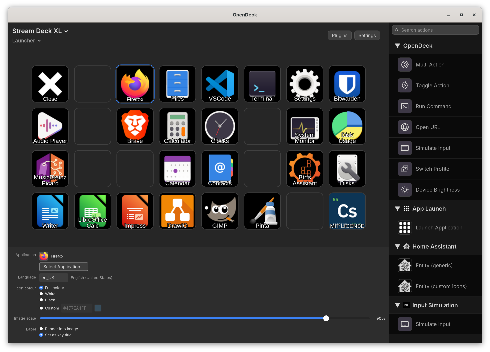

# App Launch

An [OpenDeck](https://github.com/nekename/OpenDeck) plugin that puts your installed desktop applications on Stream Deck keys. Pick an app from a list, and the key gets the app's icon and name. Press the key to launch it.



## Features

- Lists every installed application, including Flatpaks, by scanning `.desktop` files.
- Shows application names in the language you choose (for example `es` shows "Archivos" instead of "Files").
- Renders each icon as a PNG sized for the key, from SVG or raster icons, in your choice of:
  - **Full colour**: the icon as the app defines it
  - **White** or **Black**: a flat single-colour version
  - **Custom**: any colour, including transparency, entered as `#RRGGBB` or `#RRGGBBAA`
- Adjustable icon scale from 20% to 100% in 5% steps.
- Label either drawn into the key image or set as the key's title.
- Searchable application picker with keyboard support.

## Requirements

- OpenDeck 2.14 or later on Linux. Earlier versions (tested with 2.12.1) can reset the icons on your other keys to the default grid icon when you add a new action. Restarting OpenDeck restores them.
- Python 3
- PyGObject with GTK 3, librsvg, GdkPixbuf, Pango and pycairo
- `gtk-launch` (and `gio`) to start applications

Fedora Workstation already has everything above. On other distributions, install the equivalents of:

| Fedora | Debian / Ubuntu |
| --- | --- |
| `python3-gobject` `python3-cairo` | `python3-gi` `python3-gi-cairo` |
| `gtk3` `librsvg2` | `gir1.2-gtk-3.0` `gir1.2-rsvg-2.0` |

The plugin has only been tested on Fedora so far.

## Install

1. Get the plugin into this folder, with the folder name unchanged:

   ```
   ~/.config/opendeck/plugins/cloud.caesium.applaunch.sdPlugin
   ```

   - **From a release:** download `cloud.caesium.applaunch.sdPlugin.zip` from the [Releases](../../releases) page and unzip it into `~/.config/opendeck/plugins/`.
   - **From source:** clone the repository straight into that folder:
     `git clone https://github.com/alanmur/opendeck-app-launcher.git ~/.config/opendeck/plugins/cloud.caesium.applaunch.sdPlugin`

3. Quit OpenDeck from its tray menu and start it again. OpenDeck only looks for new plugins at startup.

## Usage

1. In OpenDeck, drag **App Launch → Launch Application** onto a key.
2. In the settings panel, choose your options:
   - **Language**: type a language code such as `de`, `fr` or `pt_BR`. The language's own name appears next to the box. It starts as your system language.
   - **Icon colour**: full colour, white, black, or custom. The colour box and swatch are only active for custom.
   - **Image scale**: how much of the key the icon fills.
   - **Label**: draw the name into the image, or set it as the key title so you can style it in OpenDeck.
3. Press **Select Application…**, choose an app and press **OK**.
4. Press the key on your deck to launch the app.

Changing any option updates the key you are editing straight away. Options are shared as defaults, so other keys keep the look they were built with until you edit them.

### Label styling

When the label is drawn into the image, its colours follow the icon colour setting:

| Mode | Text | Outline |
| --- | --- | --- |
| Black | black | white, none |
| White | white | black, none |
| Custom | custom colour | black, thin |
| Full colour | white | black, thin |

## How it works

OpenDeck starts a small Python process for the plugin. It scans these folders for `.desktop` files:

- `~/.local/share/applications`
- `~/.local/share/flatpak/exports/share/applications`
- `/var/lib/flatpak/exports/share/applications`
- `/usr/local/share/applications`
- `/usr/share/applications`

When two files share a desktop ID, the earlier folder in that list wins, so your own overrides take priority. Entries marked `NoDisplay` or `Hidden`, and apps whose `TryExec` program is missing, are skipped.

The settings panel is plain HTML and JavaScript. It never touches the filesystem and talks to the Python process through OpenDeck. Icons are looked up in your current GNOME icon theme and drawn with cairo, librsvg and Pango. Single-colour modes prefer an app's `-symbolic` icon and fall back to a silhouette of the full-colour one.

Pressing a key runs `gtk-launch <desktop-id>`, falling back to `gio launch <file>`. If both fail, the key shows OpenDeck's alert.

## Troubleshooting

- **The action doesn't appear in OpenDeck.** Fully quit OpenDeck from the tray and start it again. Closing its window only hides it.
- **Something else is wrong.** Check `applaunch.log` in the plugin folder. It is recreated each time the plugin starts.
- **An app is missing from the list.** The app needs a `.desktop` file in one of the folders above, and must not be hidden.

## Development

The plugin has no build step.

| Path | Purpose |
| --- | --- |
| `manifest.json` | Plugin and action definition |
| `bin/plugin.py` | Connection to OpenDeck and event handling |
| `bin/apps.py` | `.desktop` file scanning and localisation |
| `bin/render.py` | Icon lookup and key image rendering |
| `pi/` | Settings panel (HTML, JS, CSS) |
| `tools/make_icons.py` | Regenerates the plugin's icons |
| `build.sh` | Builds the release zip into `dist/` |

OpenDeck runs `bin/plugin.py` as `plugin.py -port N -pluginUUID UUID -registerEvent EVENT -info JSON`, using the Elgato Stream Deck plugin protocol.

### Specification

[`docs/spec2.md`](docs/spec2.md) is a complete, precise specification of this plugin: the design decisions and the reasons for them, the exact manifest, data model and behaviour rules, the settings panel, packaging, and the publishing steps. It also contains a numbered test plan, with automated tests and tests that need a person at a real Stream Deck.

It is written so that an AI coding assistant can rebuild the plugin from it and check the result against those tests, and so that a human can read it to understand why the plugin works the way it does. If you change the plugin's behaviour, update the spec and its tests alongside the code.

## Contributing

Issues and pull requests are welcome.

## License

[MIT](LICENSE)
